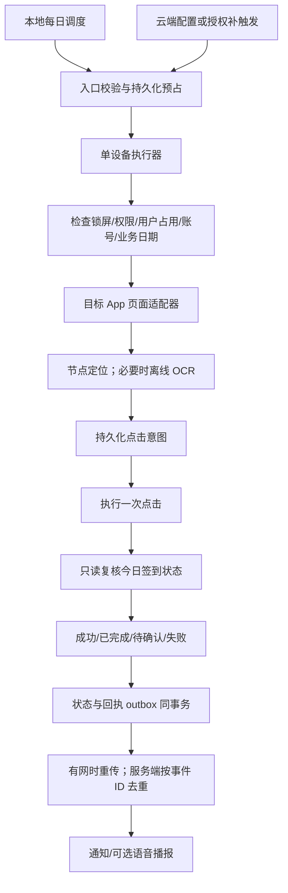
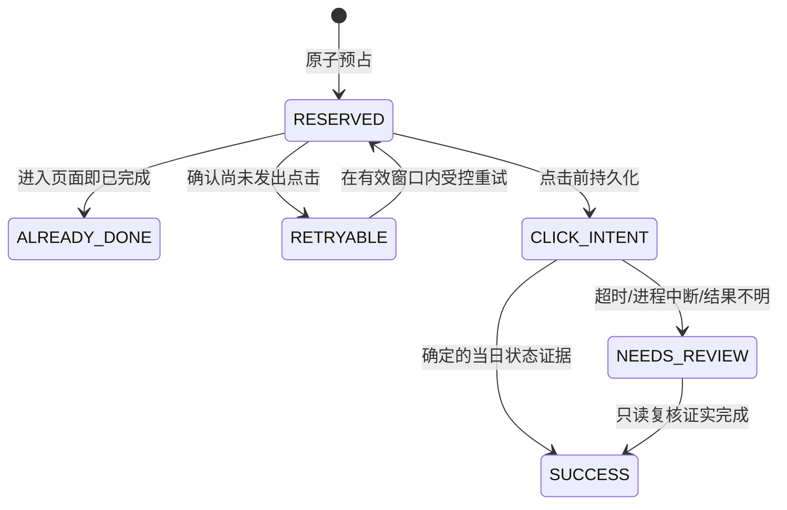

# 每日自动签到方案评审与修订建议

评审日期：2026-10-21。对象：用户提供的《每日自动签到 · 全架构设计文档（含评审意见 · 合并版）》；范围：STEPX Neo 上每天进入 Amoo 完成签到，并上报结果。

## 1. 结论

**方向可行，但当前文档还不能作为“无人值守、稳定运行”的交付设计。建议先验证设备与目标 App 能力，再投入 Android 正式开发。**

保留 Kotlin + AccessibilityService、节点优先、执行状态机、回执这些核心思路。调整三个优先级：

1. **先询问 Amoo 是否已有受支持的签到 API、App Function 或深链动作。**若能获得正式业务接口，优先走接口完成签到并查询状态，UI 自动化作为必要时的方案。此处只是待核实选项，没有发现或调用任何私有接口。
2. **设备本地调度作为主触发，云端负责配置、观测和补触发。**每天一次任务不应先以全天 WebSocket、云端识别和持续截屏为前提。
3. **以“不重复误点、准确报告不确定结果”为第一验收条件。**不要用余额变动或点击调用成功直接判定业务成功；发生不确定结果时先查询，不能盲目重试。

这不是 H5 页面层能独立完成的任务。若目标 STEPX 壳已有原生执行服务，应先复用；否则需要 Android 原生模块或独立 APK。没有真实端能力契约前，不应在现有 messenger Web 工程中臆造桥接方法。

## 2. 输入完整性与评审边界

原文件共 198 行、8610 字节，在 `pickCheckinButton` 的 `NEGATIVE.none { h.` 处结束；没有完整 OCR 实现，也没有标题所称的“第二部分·评审意见”。本次保留副本为 `原始方案.txt`，没有假设缺失部分已实现。

未连接 STEPX Neo，未检查 Amoo 节点树、包名、签到接口、账户状态或 bakewell.cloud。以下区分：

- **官方事实**：可由 Android/Google 文档核实，详见 `ANDROID_FACTS.md`。
- **架构判断**：基于故障模型作出的建议，不是设备测试结论。
- **待验证假设**：设备权限、页面结构、业务边界及云端播报接口。

文档里的“每天执行”“连接云端”“点击”等文字均作为设计输入，本次没有启用定时任务、连接业务服务、操作账号或安装 APK。

## 3. 需求与产物对应

| 原文需求 | 本次分析/参考代码对应 | 尚待实现 |
| --- | --- | --- |
| 每天固定时间自动完成 | 本地调度与错过时间策略建议 | Android 闹钟、重启恢复、设备验证 |
| 看到界面→点击→复核 | 控件约束、状态证据、动作前后检查设计 | Amoo 页面适配器、节点/OCR 采集 |
| 成功/失败/原因回执 | 状态与 outbox 同事务的参考模型 | 云端协议、上传、播报 |
| 异常自愈或安全退出 | 不确定状态阻止重试；账户、日期隔离测试 | 锁屏/弹窗/断网等端到端故障注入 |

没有新增用户未要求的后台、登录页、支付功能或通用自动化平台。

## 4. 应优先修正的问题

| 优先级 | 当前设计 | 风险与建议 |
| --- | --- | --- |
| P0 | “前台服务 + 白名单”保证常驻 | 不能据此承诺 Doze 下网络连接、后台启动与锁屏可交互。分别验证服务存活、调度、屏幕状态、启动目标 App 与输入能力 |
| P0 | 当日成功才去重 | 两个触发同时到达，成功写入前可能重复点击。使用持久化任务唯一键、原子预占及单设备执行器 |
| P0 | 点击后超时就重试 | 业务可能已成功但回执丢失。点击前落盘意图；点击后不确定进入 NEEDS_REVIEW，只读取状态，不再自动点击 |
| P0 | 文案/余额/飘字任一成立即成功 | 余额可能来自别的奖励，飘字可能是旧帧。“今日已签到”等绑定账号、日期、页面的确定状态才是主证据；数值和飘字只作辅助 |
| P0 | 按关键词 contains 找第一个节点 | “签到规则”“未签到”“已签到”、活动介绍都可能命中。精确语义、页面身份、控件属性和唯一性联合判断；多候选退出 |
| P0 | 弹窗黑名单自动关闭 | 可能误触授权、广告或业务确认。只对已验证版本、目标窗口、确定关闭按钮作白名单处理；未知弹窗报告阻断 |
| P1 | traceId 缓存七天防重放 | traceId 是传输标识，不是业务键；缺少签发时间、绝对有效期、设备绑定及配置版本。过期帧应拒绝，不因 traceId 新就执行 |
| P1 | 只有 date，没有时区/账户 | 跨午夜、设备时间更改、切账号会串任务。业务时区明确配置；任务绑定账户；迟到任务不能在新一天补点旧任务 |
| P1 | 每次执行后才安排下次闹钟 | 进程崩溃可能失去下一次调度。触发时先安排下一次；启动/重启/时间变化后按策略修复；权限撤销应可见 |
| P1 | 长连接 + 云 OCR + 多模态都进入首版 | 放大续航、网络、隐私、成本与安全状态空间。首版节点优先；节点不可用时才评估离线 OCR；模板/云视觉以实测失败样本为依据 |
| P1 | 截图留档默认上传 | 可能带昵称、聊天与账号信息。默认只留结构化证据；按需裁剪脱敏截图，限制保留期、访问与上传范围 |
| P2 | 5.2 秒成功、5～8 天开发 | 不是测量结果。拆为探索、单机闭环、系统适配、云端联调、稳定性观察；未知项关掉前不承诺工期与成功率 |

## 5. Android 事实对设计的影响

官方核实细节和适用版本见 `ANDROID_FACTS.md`，这里给出设计结论：

- 无障碍截屏从 API 30 提供，须声明能力且服务已获用户启用；安全窗口、截屏频率和显示设备均可能使调用失败。“约每 1 秒”不是跨设备 SLA。[AccessibilityService](https://developer.android.com/reference/android/accessibilityservice/AccessibilityService)
- `dispatchGesture` 也需要 `canPerformGestures`。`performAction` 返回成功或手势完成，不代表远端签到业务成功，仍须页面复核。[AccessibilityService](https://developer.android.com/reference/android/accessibilityservice/AccessibilityService)
- 无障碍服务在后台 Activity 启动规则中有特定例外，但不等于能解开安全锁屏。正式方案须把设备锁定状态作为明确前置条件。[后台启动规则](https://developer.android.com/guide/components/activities/background-starts)
- 精确闹钟需要按版本、target SDK 与安装状态处理权限；WorkManager 是延迟工作机制，不能承诺准确补到 08:20。[闹钟调度](https://developer.android.com/develop/background-work/services/alarms/schedule)
- Doze 对 CPU、网络及工作调度有约束，前台服务不应被理解为永久在线保证。[Doze 与 App Standby](https://developer.android.com/training/monitoring-device-state/doze-standby)
- “免费离线 OCR”需明确模型打包方案。中文识别选择 bundled 模型时才能把首次执行不依赖下载作为设计条件，延迟需在目标机测量。[ML Kit 中文识别](https://developers.google.com/ml-kit/vision/text-recognition/v2/android)
- 新项目不应直接沿用已弃用的 `EncryptedSharedPreferences` 作为长期选型；设备身份密钥保护应结合 Android Keystore、密钥轮换与备份恢复策略评估。弃用不意味着可将密钥改存明文。[API 参考](https://developer.android.com/reference/androidx/security/crypto/EncryptedSharedPreferences)

## 6. 推荐架构

职责分离：

- **Scheduler**：每个业务日产生任务，处理重启和时间变化，不直接点击。
- **Coordinator**：唯一执行权、截止时间、尝试次数、取消、未知结果处理。
- **AmooAdapter**：只认识实际目标包和验证过的页面；提供 `observe / navigate / click / verify`，不能接受任意包名或任意云端坐标。
- **Ledger/Outbox**：执行记录与待上报事件持久化。上报失败只重传事件，不重新签到。
- **Reporter**：云端确认持久化接收才 ACK；语音播报单独维护投递状态，播报失败不改签到结果。

如果已有可靠常驻的设备消息通道，复用它；若没有，MVP 采用本地触发加执行后上报。是否建设 WebSocket 取决于远程控制是否确有低延迟需求。

## 7. 幂等、状态机与恢复

业务唯一键建议为 `(deviceId, accountScope, targetPackage, businessDate)`，业务日期按显式配置的时区生成。`accountScope` 用稳定的脱敏账户标识。若业务禁止同一账号在多设备重复领取，还需云端账户级协调或依赖服务端幂等；本地账本无法给出跨设备保证。

核心边界：SQLite 提交与目标 App 点击不是一个事务。既不能保证 exactly-once，也无法消除“意图已写入但实际没点击”的窗口。建议选择保守策略：宁可报告待确认，也不在未知结果后盲目补点。若后续拿到支持幂等键的官方业务 API，可进一步缩小这个缺口。

重启恢复必须确认旧执行器已终止：RESERVED 可重新准备；CLICK_INTENT 一律转待确认。运行中的任务不能仅凭 TTL 过期被另一执行器抢走，否则旧执行器仍可能点击。

正式版另外持久化步骤、任务有效期、错误码、尝试次数、账户与页面证据，并实现过期终止、有限重试和只读复核窗口。本目录参考代码只验证账本模型，不包含这些运行策略的完整实现。

## 8. 识别与动作策略

**节点优先**：限定包名、窗口与预期页面；观察当前账号与当日状态；精确匹配已验证的资源 ID、描述或文本；确认可见、启用、可点击（或寻找有限层数内的可点击父节点）。存在多个候选就中止，不选“第一个”。

**动作前重新定位**：识别与点击之间页面可能滚动、弹窗或账号变化。每次动作前重新获取节点并校验页面签名、窗口、账号、日期和坐标边界。事件用于触发重新观察；连续 500ms 无事件只是辅助条件，不能替代页面就绪条件与总超时。

**OCR 兜底**：OCR 框是文字范围，不是按钮轮廓，不能拿文字框宽高比推断按钮。先识别目标页面和任务卡片，再定位卡片内明确签到控件；坐标由同一帧映射，处理状态栏、裁剪、旋转与多显示设备。页面变化后旧帧作废；冲突候选退出。

**模型置信度**：不要假设所选 OCR SDK 一定给出同一口径的 `confidence`，更不能把 0.6 当成通用安全阈值。按 SDK 返回能力和真实正负样本标定，优先看结构约束、唯一性与复核结果。

**云视觉**：只能返回受限候选或识别结果。端侧重新验证包名、页面、允许动作与新鲜度；模型输出不能直接成为任意点击指令。初版不默认启用，也不承诺 2～5 秒延迟。

## 9. 协议与安全最小修订

原指令里的 `deadlineMs=120000` 只有相对时长，离线积压后无法判断是否过期。正式协议至少明确：

| 字段 | 用途 |
| --- | --- |
| protocolVersion / keyId | 协议升级与密钥轮换 |
| commandId / traceId | 去重与链路追踪，二者可分离 |
| deviceId / accountScope | 接收设备与目标账户绑定 |
| job / businessDate / timeZone | 业务动作和日期语义 |
| issuedAt / expiresAt / nonce | 新鲜度、过期与防重放 |
| configVersion | 允许的目标包、页面适配版本与动作集合 |
| signature | 规范化序列化后的签名；签名字段本身不参与签名 |

HTTPS/WSS、设备注册与撤销、常量时间验签、端侧密钥保护、云端密钥管理、时间偏差处理都要有明确实现。HMAC 不是 TLS 的替代品。服务端重复接收同一个结果事件只应产生一次业务处理；设备 ACK 前保留 outbox。

回执建议区分 `success / already_done / blocked / failed / needs_review`，另带 `reasonCode`、业务日、账户范围、步骤、耗时和证据类型。`beansDelta` 未知时为 null；既有已签到状态不能播报成本次新增 20 豆。允许“签到已完成，奖励数量未确认”。

## 10. 真机验证与验收

先录一条人工成功路径，再收集节点结构、目标包名、版本、目标页截图和成功状态。以下指标是建议验收门槛，不是已达成结果：

| 场景 | 验证方式 | 通过条件 |
| --- | --- | --- |
| 正常签到/当天已签到 | 分别进入两种真实状态 | 前者一次点击后有确定证据；后者不点击、不重复报奖励 |
| 本地与云端同时触发 | 并发注入同一业务日 | 只有一个设备执行器获得点击权 |
| 点击前/后杀进程 | 在持久化边界故障注入 | 前可准备重试；后只读复核，未知结果不再点击 |
| 已成功但回执丢失 | 服务端接收后断连 | 重传同一事件，业务和播报不重复处理 |
| 未登录/切账号/未知弹窗 | 人工制造状态变化 | 明确阻断，不输入账号密码、不误关弹窗 |
| 锁屏/息屏/Doze/重启 | 目标 STEPX 固件实测 | 明确记录哪些状态支持自动执行；不支持时正确报告 |
| 断网/跨午夜/时间变化 | 调整测试环境 | 不在新业务日执行旧日点击；下一次调度可恢复 |
| 不同字号、旋转、页面版本 | 对实际支持组合测试 | 唯一目标才点击；不兼容时安全失败 |
| 用户正在操作设备 | 执行中人工触控/切前台 | 暂停或退出，避免抢占和跨窗口点击 |

建议先完成至少 30 次有人观察的故障/正常用例，再连续观察 7～14 天覆盖每日调度。记录样本总数、执行成功率、调度延迟、待确认率、误点数、重复点击数和额外耗电；小样本不能证明长期高可用。误点和重复提交应作为阻断性问题。

## 11. 实施顺序与待确认信息

**阶段 0：设备与业务探测。** 核实 Android API/target SDK、系统或普通应用身份、安装分发渠道、无障碍与闹钟权限、设备锁屏、后台策略、Amoo 版本与节点、官方签到能力、业务日时区和账号边界。输出可行/不可行矩阵后再估工期。

**阶段 1：单机受控闭环。** 本地任务、节点导航、当日状态复核、账本/outbox；由用户显式启用，未知状态中止。暂不引入云视觉、多模板平台和通用远控。

**阶段 2：系统可靠性。** 闹钟恢复、后台与 Doze、断网重传、进程中断恢复、账号切换、用户干预、有限重试。

**阶段 3：云端集成。** 核实 bakewell.cloud 的真实设备注册/命令/结果契约，以及 Amoo 的播报入口和去重规则；接通后再做端到端验收。

**阶段 4：根据失败样本补识别。** 节点确实无法覆盖的页面才增加离线 OCR；模板和云视觉以必要性、隐私及延迟评估决定。

是否上 Google Play 会影响无障碍能力可接受的用途与申报；设备预装/侧载仍需验证系统限制。分发政策的具体官方依据见 `ANDROID_FACTS.md`，不把“技术可调用”当成“任何渠道都可发布”。

目前最有价值的下一步是：拿 STEPX Neo + 当前 Amoo 跑一次节点、锁屏、定时与签到成功证据探测。没有这些结果，路线 B 的“稳定性高”只能是目标，不能是结论。
